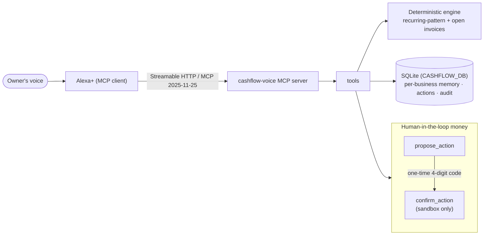

# Cashflow Voice — an Alexa+ MCP server for small-business cash flow

> "Alexa, can I make payroll next month?"
> "You have 1.87 million yen today. Cash dips below zero in the week of December 21 — want a plan?"

Cashflow Voice is a **self-hosted MCP server (spec 2025-11-25, Streamable HTTP)** for the
**Alexa+ track** (priority category: *business systems*). It turns a café or shop owner's
bank CSV and open invoices into spoken answers, a 13-week forecast, and a ranked plan to
avoid a cash crunch — and it never moves money without a spoken confirmation code.

## Why

Most small businesses that fail run out of cash, not customers. Owners are busy on the
floor, not in spreadsheets. Voice is where they already are (kitchen, counter, car).

## What it does (MCP tools)

| Tool | Purpose |
|---|---|
| `import_transactions` | Load a bank CSV (date, description, amount[, category, counterparty]) |
| `import_invoices` | Load open invoices (id, counterparty, amount, due_date, receivable/payable) |
| `cash_position` | Balance today + one-sentence 13-week outlook |
| `forecast_cashflow` | Week-by-week forecast with the drivers behind each week |
| `can_i_afford` | "Can I buy a ¥400k oven on Nov 2?" against a safety buffer |
| `shortfall_plan` | Ranked fixes: chase receivables early, defer bills, draw only the gap |
| `propose_action` | Prepare an action; returns an id + 4-digit code. Nothing executes |
| `confirm_action` | Executes in **sandbox** only after the owner reads back the code |
| `cancel_action` | Cancel a pending action |
| `remember` / `recall` | Context that survives across Alexa sessions |
| `audit_log` | Every import, question, proposal and confirmation, timestamped |

## How it works



- **Deterministic numbers.** The LLM speaks; the engine calculates. Same input, same answer.
- **Human-in-the-loop money.** Two-step propose → confirm with a one-time code, no replay,
  per-business isolation, sandbox execution.
- **Prompt-injection hygiene.** Transaction text is treated as data (see tests).
- **Memory across sessions.** SQLite per business (`CASHFLOW_DB`).

## Run locally

```bash
pip install -e ".[dev]"
ruff check . && pytest -q                    # lint + 17 tests
CASHFLOW_TODAY=2026-10-19 cashflow-voice     # serves http://0.0.0.0:8000/mcp
python scripts/demo_client.py http://127.0.0.1:8000/mcp
```

Environment variables: `HOST` (default `0.0.0.0`), `PORT` (default `8000`),
`CASHFLOW_DB` (SQLite path; default in-memory), `CASHFLOW_TODAY` (pin "today" for demos,
JST otherwise), `CASHFLOW_DATA` (demo CSV dir), `CASHFLOW_TOKEN` (see below).

## Auth

`CASHFLOW_TOKEN` turns on a static bearer check for every endpoint except `GET /healthz`.
Unauthenticated calls get a bare `401` — **no `WWW-Authenticate` header**, as Alexa+
discovery requires. Unset = open access for local development.

```bash
CASHFLOW_TOKEN=secret123 cashflow-voice
curl -X POST http://127.0.0.1:8000/mcp \
  -H "Authorization: Bearer secret123" -H "Content-Type: application/json" \
  -H "Accept: application/json, text/event-stream" \
  -d '{"jsonrpc":"2.0","id":1,"method":"ping"}'
```

## Deploy to Render (free tier)

`Dockerfile` + `render.yaml` are already wired. You click; nothing here touches your account.

1. Push this repo to your GitHub (public).
2. Render dashboard → **New** → **Blueprint** → connect the repo → **Apply**
   (`render.yaml` creates a free Docker web service with `healthCheckPath: /healthz`).
3. When the deploy is green, copy the generated token:
   **your service → Environment → `CASHFLOW_TOKEN`** (auto-generated).
4. Your endpoint: `https://<service>.onrender.com/mcp`.
   Verify: `curl https://<service>.onrender.com/healthz` and an MCP `ping` with the bearer header.
5. Point Alexa+ at it: `alexa-ai configure` → `alexa-ai new mcp --mcp-server-url https://<service>.onrender.com/mcp`
   (requires your Amazon developer account — see `docs/SUBMISSION.md`).

Caveats on the free plan: the service sleeps after ~15 min idle (first request after a
cold start can exceed Alexa+'s 500 ms latency target) and `/tmp` storage is ephemeral —
`CASHFLOW_DB` resets on redeploy. Both are fine for judging; upgrade or use a persistent
disk for production. **Demo-day tip:** a free uptime monitor (e.g. cron-job.org,
UptimeRobot) pinging `https://<service>.onrender.com/healthz` every 5–10 min keeps the
service warm so judges never hit a cold start.

## Performance

Deterministic engine → no LLM latency in the loop. Measured locally (uvloop + httptools
via `uvicorn[standard]`): **~5 ms median per tool call**, ~44 ms mean for 20 parallel
calls — comfortably inside Alexa+'s 500 ms budget. Every response carries an
`X-Response-Time-Ms` header so the budget is measurable end to end. Forecasts are
memoized per (business, week-count, day, data-version) and SQLite runs WAL + a single
locked connection.

## How judges can test it

- **MCP Inspector:** `npx @modelcontextprotocol/inspector` → Streamable HTTP →
  `https://<service>.onrender.com/mcp` (+ `Authorization: Bearer <token>`).
  Locally: `http://127.0.0.1:8000/mcp`, no auth needed.
- **Scripted conversation:** `python scripts/demo_client.py <url>` runs the whole story —
  balance → affordability → shortfall plan → propose → confirm (sandbox) → remember → audit.
- **Nothing real ever moves:** `confirm_action` only executes in sandbox mode, and only
  with the one-time code returned by `propose_action`.

## Demo walkthrough (the story the video tells)

1. *"Alexa, how's my cash?"* → `cash_position` → "You have 1.87 million yen today…"
2. *"Can I buy a new oven for 400,000 yen on November 2nd?"* → `can_i_afford` → not safely.
3. *"What should I do?"* → `shortfall_plan` → defer BILL-88 (supplier) first.
4. *"Do it."* → `propose_action` returns e.g. `ACT-64D28E` + code `3 9 6 3`.
5. *"Three nine six three."* → `confirm_action` → executed in sandbox; `audit_log` shows the trail.
6. New session → `recall` → "payroll is always the 25th" survived the restart.

## Demo data

`data/sample_transactions.csv` and `data/invoices.csv` model a small Tokyo café.
Import your own via `import_transactions` / `import_invoices` — every business id is isolated.

## License

MIT
